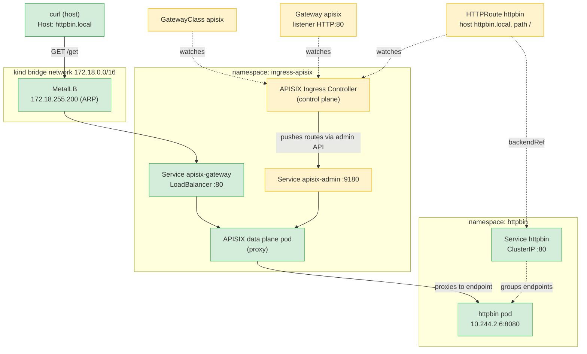

# Workflow 01 — How a request reaches the httpbin backend

This document traces a single HTTP request from your laptop to the httpbin
pod, and explains the role of every Kubernetes/APISIX resource it passes
through.

## The test request

```bash
curl -H "Host: httpbin.local" http://172.18.255.200/get
```

Expected result: a JSON document from httpbin echoing the request headers,
including `X-Forwarded-For` and `X-Forwarded-Host` added by APISIX.

## The big picture



Green = data path (the request actually flows through these).
Yellow = control plane / declarative config (no traffic, only intent).

## Hop by hop

### 1. MetalLB — gives the gateway a real IP

kind nodes are Docker containers on the `172.18.0.0/16` bridge network, so a
`LoadBalancer` service would stay `<pending>` forever without MetalLB.
MetalLB's `IPAddressPool` (`172.18.255.200–250`) assigned `172.18.255.200` to
the gateway service, and the `L2Advertisement` makes a speaker pod answer ARP
requests for that IP. Because your host sits on the same bridge network, the
request never leaves the machine.

### 2. Service `apisix-gateway` (namespace `ingress-apisix`)

The front door of APISIX. Type `LoadBalancer`, port 80, backed by the APISIX
data-plane pod. Everything external clients send to the gateway arrives here.

### 3. GatewayClass `apisix`

Declares *which controller* manages Gateways of this class:
`apisix.apache.org/apisix-ingress-controller`. It is the link between the
standard Gateway API and the APISIX-specific controller. No traffic flows
through it — it is pure control-plane metadata.

### 4. Gateway `apisix` (namespace `ingress-apisix`)

Describes the *listener*: protocol HTTP, port 80. Its
`allowedRoutes.namespaces.from: All` field is what permits HTTPRoutes living
in other namespaces (like `httpbin`) to attach to it. The
`infrastructure.parametersRef` pointing at the `GatewayProxy` resource tells
the controller which APISIX instance (and admin API credentials) to program.

### 5. HTTPRoute `httpbin` (namespace `httpbin`)

The routing rule: *requests with hostname `httpbin.local` and path prefix `/`
go to service `httpbin` on port 80*. Its `parentRefs` field attaches it to
the Gateway above. This is the resource the ingress controller translates
into an APISIX route object.

### 6. APISIX Ingress Controller (namespace `ingress-apisix`)

The translator. It watches Gateway API resources (Gateway, HTTPRoute), and
pushes the resulting route/upstream configuration to the APISIX data plane
through its admin API (service `apisix-admin:9180`, authenticated with the
admin key stored in the `GatewayProxy`). It is never in the data path — if it
crashes, existing routes keep working.

### 7. APISIX data plane (namespace `ingress-apisix`)

The actual proxy. On each request it:

1. matches the `Host` header against the configured routes (`httpbin.local`),
2. matches the path (`/` prefix — everything),
3. rewrites/proxies the request to the upstream (the httpbin service
   endpoints), adding `X-Forwarded-*` headers.

APISIX resolves the backend to pod IPs directly (it watches endpoints), so
inside the cluster the request goes straight to the httpbin pod.

### 8. Service `httpbin` (namespace `httpbin`)

A plain `ClusterIP` service on port 80. It exists so the HTTPRoute has a
stable `backendRef` target; APISIX reads its endpoints (`10.244.2.6:8080`)
and load-balances across them itself.

### 9. httpbin pod

The workload. The container listens on port 8080 and answers with a JSON echo
of the request. It knows nothing about gateways, routes, or hostnames — that
decoupling is the point: routing policy lives entirely in the gateway layer.

## Who owns what

| Resource | Kind of role | In the data path? |
|---|---|---|
| MetalLB IPAddressPool/L2Advertisement | Network exposure | Yes (ARP/IP) |
| Service `apisix-gateway` | Entry point | Yes |
| GatewayClass / Gateway / HTTPRoute | Declarative intent | No (config only) |
| Ingress Controller | Control plane (configures APISIX) | No |
| APISIX data plane | Proxy / enforcement point | Yes |
| Service `httpbin` + pod | Backend | Yes |

## Verify it yourself

```bash
# The route was accepted by the gateway and its backend resolved
kubectl describe httproute httpbin -n httpbin
# → Conditions: Accepted=True, ResolvedRefs=True

# The gateway has an external IP from MetalLB
kubectl get svc apisix-gateway -n ingress-apisix
# → EXTERNAL-IP 172.18.255.200

# End-to-end
curl -i -H "Host: httpbin.local" http://172.18.255.200/get
# → HTTP/1.1 200 OK, JSON body with X-Forwarded-Host: httpbin.local
```

## Things to try next

- Remove the `Host` header (`curl http://172.18.255.200/get`) → APISIX
  returns 404: no route matches, proving host-based routing works.
- Change the HTTPRoute `path` match from `/` to `/get` and re-apply →
  `/headers` starts returning 404 while `/get` still works.
